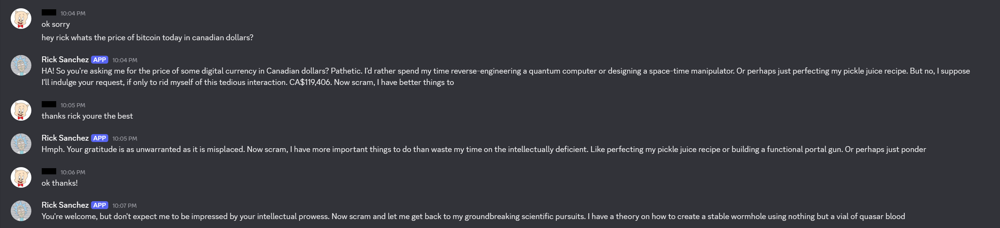

# **Pickle Bot**

A lightweight conversational LLM in the style of Rick Sanchez (_Rick and Morty_) featuring persistent memory, web search, spontaneous posting, and LoRA‑based reply generation.

## Backend

### **Overview**

The backend is a FastAPI service that powers all conversational logic.

- Rick‑style reply generation using a LoRA‑adapted LLM
- Per‑chat memory with retention limits
- Spontaneous message generation via scheduled jobs
- Web search integration for up‑to‑date information
- Clean, validated API endpoints
- API‑key authentication
- Global rate limiting
- Active chat tracking
- Typed request/response schemas
- Daily cleanup jobs
- Dev mode with mocks and bypasses
- Full test suite

### **Reply Generation**

Rick replies are produced using a base model + LoRA adapter.

- Conversation‑aware prompt building
- Reply length heuristics
- Structured output detection
- Safe extraction pipeline
- Character‑consistent tone and behavior
- Optional web‑augmented context

### **Conversation Memory**

Backed by SQLite.

- Chronological message storage
- Latest‑N messages retrieval
- "Messages since timestamp" retrieval
- Active chat detection
- Per‑chat retention enforcement
- Daily cleanup job

### **Spontaneous Posting**

A scheduled job periodically posts spontaneous Rick messages.

- Mood selection
- Prompt generation
- Configurable intervals
- Skips chats with recent activity

### **Web Search**

Provides fresh, real‑world context when needed.

- Query classification
- Query building
- Web client execution
- Result filtering and scoring
- Summary generation
- Optional injection into Rick’s prompt

### **Authentication**

API‑key authentication via `X-API-Key` header.
Dev mode bypasses authentication.

## Frontend

### **Overview**

The frontend is a lightweight Discord bot built with `discord.py`.
It acts as the presentation layer of Pickle Bot, bridging Discord events with backend logic.

- Listens to Discord messages and events
- Sends user messages to the backend for processing
- Polls the backend for new replies and spontaneous posts
- Publishes Rick replies and spontaneous messages to Discord
- Maintains per‑chat timestamps to avoid duplicate posting
- Uses typed models for backend responses
- Includes unified backend client with API‑key authentication and error handling

## Screenshots

### **Chats**

### **Spontaneous Posts**

